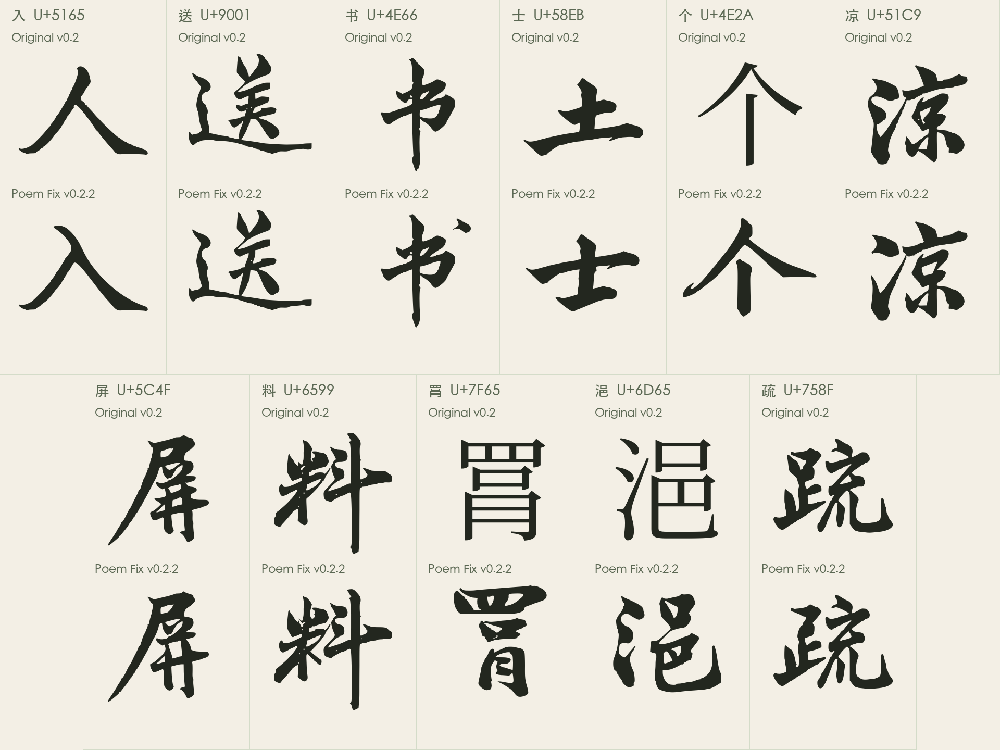

# 诗词字幕字形修订：QHDL Poem Fix

本分支在权衡度量体 v0.2 的基础上，提供独立命名的 OTF 派生字体，以及可重复构建的字形补丁。原版 `data/QuanHengDuLiang-v0.1.otf` 和 `data/QuanHengDuLiang-v0.2.otf` 保持原样。

## 字体与改动

- 文件：[`data/QuanHengDuLiang-PoemFix-v0.2.2.otf`](../data/QuanHengDuLiang-PoemFix-v0.2.2.otf)
- 家族名：`QHDL Poem Fix`；PostScript 名：`QHDLPoemFix-Regular`。
- 修订的十一个字形：**入、送、书、士、个、凉、屏、料、罥、浥、疏**。
- 入调整起笔、右肩与捺身的连续走势；书补足点画；士调整长短横的关系；凉、屏、送、料、个、罥、浥分别调整笔画、部件或衔接空间，以适合字幕辨识和同家族笔势。
- 疏将左上口状封闭改为开放横钩与中竖衔接，保留右部、左下止部和原笔势。
- 个使用本仓库 v0.1 的原生字形并有局部调整；其余修订以 v0.2 的笔画与部件为基础。



[查看 108px 字号样张](poem-glyph-sizes.png)。上下或左右对比采用同一字号与基线。

十一个字形在原字库中对应十五个 Unicode 码位：入共用 `U+2F0A`，士共用 `U+2F20`，凉共用 `U+F979`，料共用 `U+F9BE`。这些别名会随共用字形一起变化；Unicode 映射本身没有修改。

## 构建

需要 Python 3.10 或更新版本。构建只依赖仓库内原版 OTF、[`patches/poem-glyphs.json`](../patches/poem-glyphs.json) 和指定版本的 FontTools。

```sh
python3 -m venv .venv
. .venv/bin/activate
python -m pip install -r requirements-poemfix.txt
python tools/build_poem_fix.py --verify-report docs/poem-fix-validation.json
```

输出为 `data/QuanHengDuLiang-PoemFix-v0.2.2.otf`。构建工具校验输入 SHA-256 和原字形指纹，应用补丁中的最终轮廓及精确横排、竖排度量，并使用独立字体名称。字体版本与构建时间固定，以支持相同输入和依赖下的重复构建。

基线来自上游提交 `72c2d0c37a566cb0b79e8d655b27b65c610efbb0`；原版 v0.2 OTF 的 SHA-256：

```text
0829f730d241003477521cd535282c01d66fc5a20cea912c538b885a750c5e61
```

如上游更换原版文件，构建会拒绝直接套用补丁。维护者需先检查字形映射和原轮廓，再明确更新补丁基线。

## 校验范围

[两次独立构建的字节一致性记录](poem-fix-reproducibility.json)。

[`poem-fix-validation.json`](poem-fix-validation.json) 记录完整字库比较：65,535 个字形中，只有上述十一个轮廓变化；其他字形的横排、竖排度量保持；全部 Unicode cmap 子表、UVS、字形顺序、排版表及 UPM 保持。修订轮廓和度量必须与补丁内容一致，字体版权与许可保留。

本分支只构建 OTF 派生版。样张用于观察字形、笔势和实际字幕字号，数据校验用于确认修改范围及字体完整性。

## 版权与许可

- 上游项目的 MIT 原文保留于 [`LICENSE`](../LICENSE)。
- v0.2 字体含 Source Han 的 OFL 字体数据；派生 OTF 和字形轮廓补丁保留该许可，见 [`licenses/OFL-1.1-SourceHan.txt`](../licenses/OFL-1.1-SourceHan.txt)。
- 新构建工具采用 MIT 许可。完整来源与修改说明见 [`FONT-NOTICES.txt`](../FONT-NOTICES.txt)。
